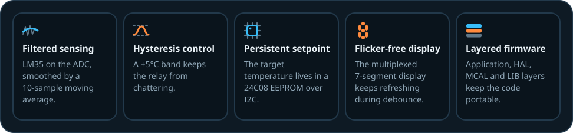
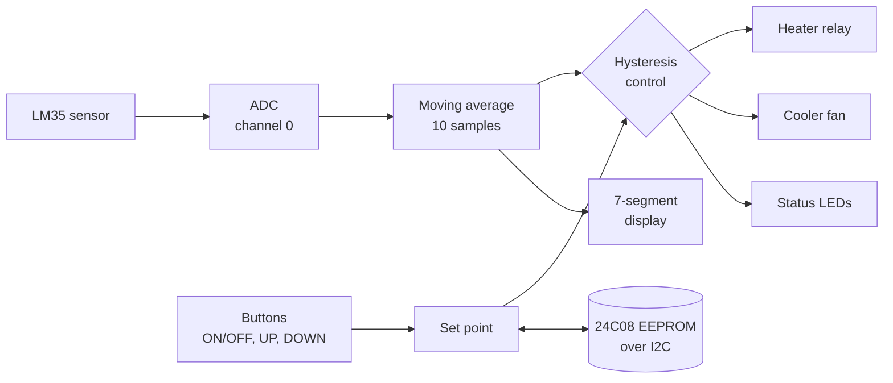
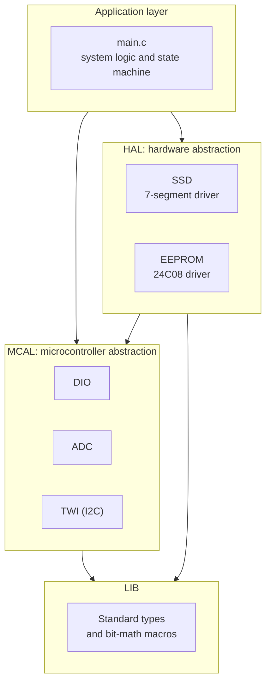

 

 

Firmware for an electric water heater built around the **ATmega32**. It reads the water temperature from an LM35 sensor, keeps it near a user-chosen set point with a hysteresis band, shows it on a multiplexed 7-segment display, and stores the set point in an external I2C EEPROM so it survives a power cut. The code is split into Application, HAL, MCAL and LIB layers, so each driver can be reused or ported on its own.

## How it works

1. **Sense.** The ADC samples the LM35 and a 10-reading moving average removes noise, so the displayed and controlled value does not jump around.
2. **Decide.** The control logic compares the filtered temperature with the set point and keeps it within a **±5°C** band. The band prevents the relay from switching on every small fluctuation, which extends the life of the hardware.
3. **Act.** The heater relay, the cooler fan and the status LEDs follow the decision.
4. **Remember.** When the user changes the set point with the UP and DOWN buttons, it is written to the 24C08 EEPROM and restored at the next power-up.
5. **Display.** The 7-segment display is refreshed continuously, including while the firmware waits for button debounce, so it never flickers.

## Features

| Area | What it does |
|---|---|
| Temperature sensing | LM35 on ADC channel 0, with a moving average filter over a buffer of 10 readings |
| Display | 2-digit multiplexed common-cathode 7-segment display showing the temperature in real time |
| Flicker-free refresh | The refresh rate is maintained during button debounce delays and other blocking loops |
| Controls | Three buttons: ON/OFF, UP and DOWN |
| Hysteresis | Holds the temperature within ±5°C of the set point and prevents relay chattering |
| Outputs | Heater (relay), cooler (fan) and status LEDs |
| Persistence | The desired temperature is saved to an external 24C08 EEPROM over I2C and survives power loss |

## Software architecture

The firmware is organised as a layered architecture. Each layer only calls the one below it.

| Layer | Module | Responsibility |
|---|---|---|
| Application | `main.c` | System logic and state machine |
| HAL | `SSD` | 7-segment display driver |
| HAL | `EEPROM` | External memory driver (24C08) |
| MCAL | `DIO` | Digital I/O control |
| MCAL | `ADC` | Analog-to-digital converter |
| MCAL | `TWI` | Two-wire interface (I2C) |
| LIB | Types and bit math | Standard types and bit-manipulation macros |

## Hardware specifications

| Item | Specification |
|---|---|
| Microcontroller | ATmega32, 8 MHz clock |
| Temperature sensor | LM35, ADC channel 0 |
| Display | 2-digit multiplexed 7-segment, common cathode |
| Input | 3 push buttons (internal or external pull-up) |
| Output | Relay (heater), motor (cooler), LEDs |
| Memory | 24C08 external EEPROM over I2C |

## Simulation

The design is simulated in Proteus.

## Build and run

1. Build the project for the **ATmega32** with the clock defined as **8 MHz**, using Microchip Studio or `avr-gcc`.
2. Open the Proteus design and load the generated `.hex` file into the ATmega32.
3. Start the simulation, set the sensor temperature, and use the UP and DOWN buttons to change the set point.

## Safety note

This is a simulation and learning project. A real water heater switches mains voltage, so a physical build would also need an independent hardware over-temperature cutoff, proper isolation between the microcontroller and the mains side, and a suitably rated relay.

## Credits

Built with embedded C for the AVR ATmega32. The banner and logo use the [Bricolage Grotesque](https://github.com/ateliertriay/bricolage) and [Figtree](https://github.com/erikdkennedy/figtree) typefaces under the SIL Open Font License (see `assets/`).
